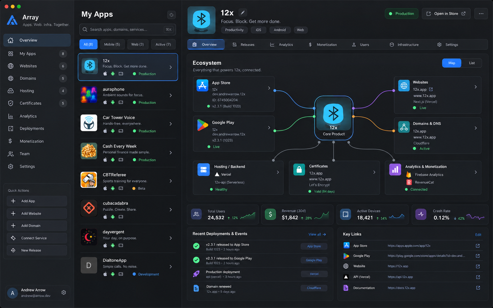
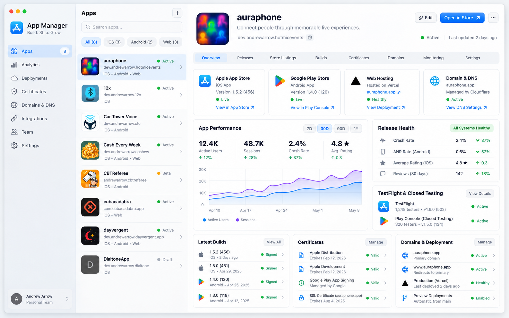
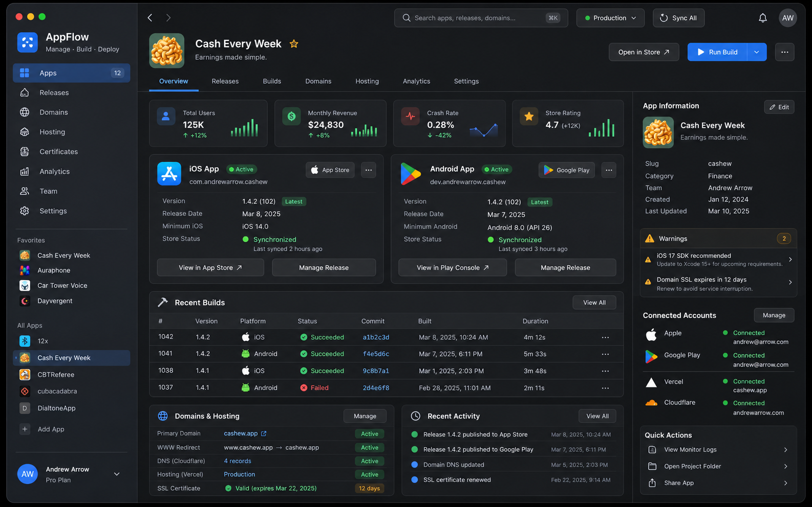
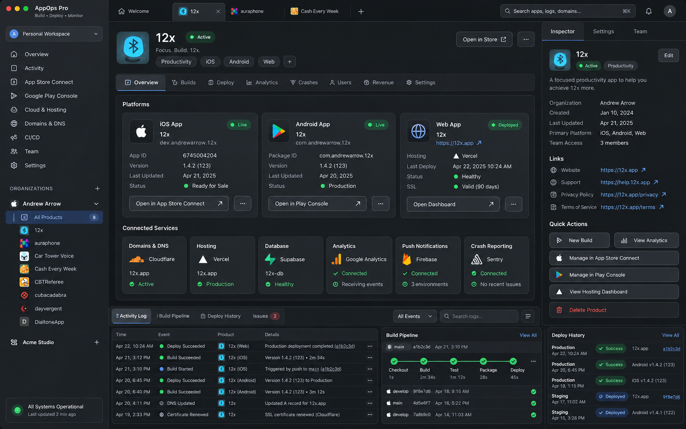

# DeployerCoaster
desktop installed based software for developers to help with app store connect, google play store, domain registration, and hosting

# Screenshots

# Details

Run the desktop studio with `cargo run --manifest-path studio/Cargo.toml`.

Studio starts with **Open App**, **Create New**, and **Recent Apps**. Open App
lists the iOS apps available to your saved Apple API key; add it in
**Settings → Apple** if needed. The list is cached on disk for 24 hours.
Selecting an app opens its information without a navigation tree and remembers
it locally for next time. The cache and the ten most recent apps are scoped to
the Apple account. **File → Close App** returns to the startup screen;
**File → Open App** lets you choose another app. Create New is a no-op for now.

Studio uses the [Parsequerade Rust SDK](https://github.com/mainbrella/parsequerade/tree/1442465e2d8180f3729ea8448f70fa3e15d63e4d/sdks/rust)
to call App Store Connect directly for app listings, metadata, localizations, and
age-rating updates. Cargo pins the SDK to that commit. Your Issuer ID, Key ID, and
`.p8` contents are saved locally in `DeployerCoaster/apple-credentials.json` in the
OS configuration directory, with owner-only permissions on Unix. Existing hosted
connections require entering those values again; original local credentials migrate
automatically. The [Parsequerade reference](https://parsequerade.mainbrella.com/docs/)
describes the facade resources. Live sales reports and full-app copying remain
unavailable in the SDK.

Open **Analytics** for previously cached daily and monthly App Store sales reports,
or an app's **Analytics** tab for its reports. In **Settings → Apple**, save your
App Store Connect Team Key credentials and vendor number (found in Payments and
Financial Reports). Reports show units,
developer proceeds by currency, and expandable device/version, download, update,
redownload, and country breakdowns. Reports are cached locally by account, vendor,
and period. Live downloads are unavailable. Monthly reports default to the previous
month, and daily reports to yesterday.

Open **File → Android** and choose **Connect Play Store**. It opens Google sign-in in
your default browser, receives the authorization through a local loopback callback,
and lists the account's accessible apps by title and package name. Refresh reloads
the list; Disconnect clears the session. Access and refresh tokens stay in memory
and are discarded when the app closes.

Use a Google OAuth **Desktop app** client JSON. The studio looks for it in:

1. The path set by `DEPLOYERCOASTER_GOOGLE_CLIENT_SECRET`, if supplied.
2. `DeployerCoaster/google-oauth.json` in the OS configuration directory.
3. The supplied `client_secret_40330924720-un43h7i7gmclerblihu0qjh815tfchr6.apps.googleusercontent.com.json` in Downloads.

Enable the [Google Play Android Developer API](https://console.cloud.google.com/apis/library/androidpublisher.googleapis.com)
and [Google Play Developer Reporting API](https://console.cloud.google.com/apis/library/playdeveloperreporting.googleapis.com)
in the client's Google Cloud project. Sign-in requests `androidpublisher` and
`playdeveloperreporting`: Google's [app discovery endpoint](https://developers.google.com/play/developer/reporting/reference/rest/v1beta1/apps/search)
requires the reporting scope. The Google account must have access to the apps in
Play Console. If the OAuth app is in testing, add the signing-in account to its
test users. Keep the client JSON outside the repository.
